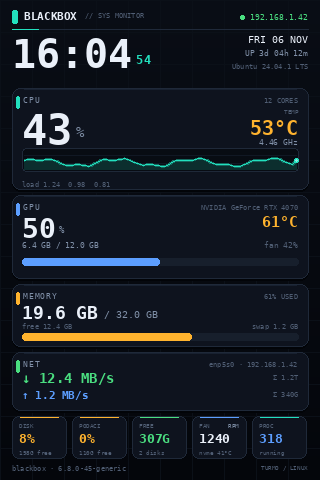
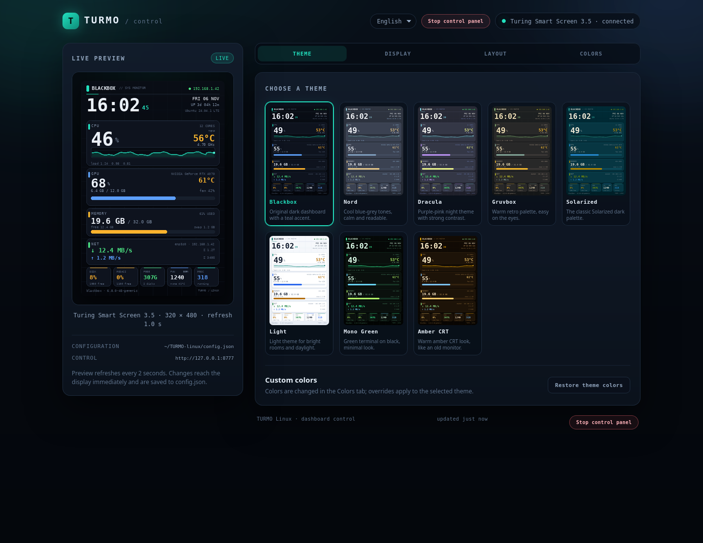
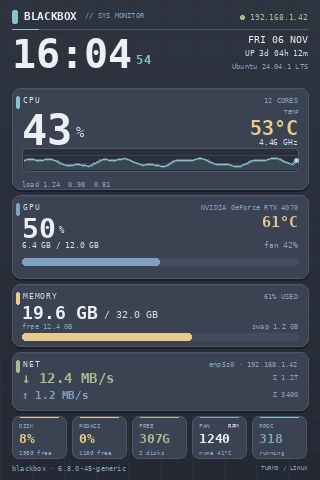
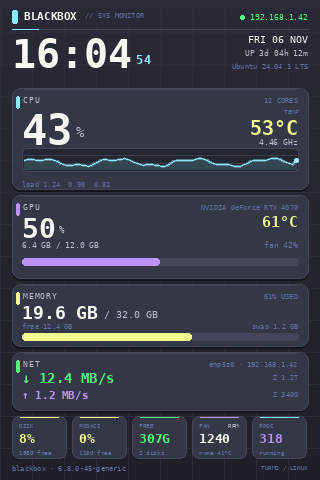
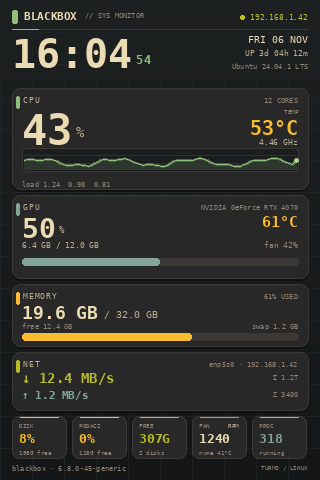
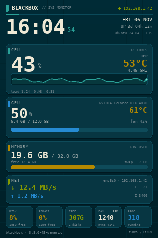
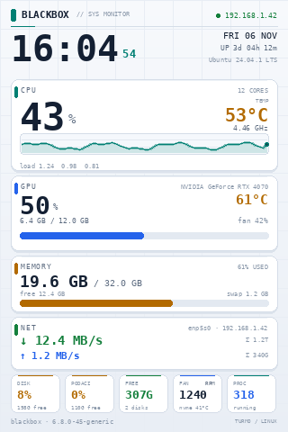
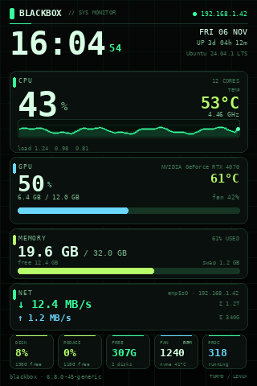
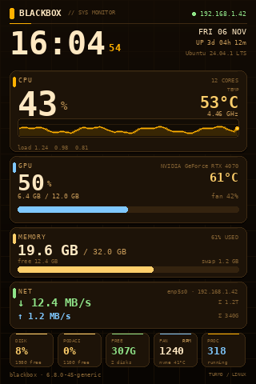

# TURMO Linux

**Unofficial Linux driver and dashboard for Turing Smart Screen / TURMO USB displays.**

TURMO is a Windows-only application for small USB smart screens. This project
brings the same class of display to Linux: a headless service renders a live
system dashboard and sends it over the serial protocol, while an on-demand local
web editor lets you change themes, panels and colors from a browser.

No Windows software, no proprietary runtime, no cloud account. Just Python,
`pyserial`, Pillow and a USB cable.

[](https://github.com/DralaX666/TURMO-linux/actions/workflows/tests.yml)
[](LICENSE)
[](https://www.python.org/)
[](#requirements)
[](#web-control-panel)





## Features

- **Live dashboard** — CPU, GPU, RAM/swap, network, disks, fan, NVMe
  temperature, clock, uptime and kernel, refreshed continuously.
- **8 built-in themes** — Blackbox, Nord, Dracula, Gruvbox, Solarized, Light,
  Mono Green and Amber CRT — plus per-color overrides.
- **On-demand web editor** — live preview, theme picker, granular panel
  toggles, title/footer text, orientation, brightness and refresh rate. It runs
  only while you edit; the display service keeps running.
- **4 UI languages** — English, German, Chinese and Serbian, selected on first
  launch and stored per browser.
- **Auto-detection and reconnects** — finds the display by USB VID/PID or name
  and reconnects after USB hiccups.
- **Systemd friendly** — runs as a system service or a per-user service.
- **Desktop shortcut** — open the control panel, edit the config or restart the
  service from the desktop.
- **Testable without hardware** — render smoke tests and theme previews work
  without a display.

## Supported hardware

| Device | USB ID | Notes |
|---|---|---|
| Turing Smart Screen 3.5" (rev. A) | `1a86:5722` | primary target, 320×480 |
| UsbPCMonitor 3.5" | `1a86:5722` | same protocol |
| UsbPCMonitor 5" | `1a86:5722` | responds to `HELLO` |
| UsbPCMonitor 7" | `1a86:5722` | responds to `HELLO` |

The udev rule also creates a stable `/dev/turmo` symlink.

## Requirements

- Linux with systemd (tested on **Ubuntu 24.04 LTS**; designed to work on
  Debian, Fedora, Arch and similar distributions with manual setup)
- Python **3.10+**
- `pyserial`, `Pillow`, `numpy` (see `requirements.txt`)
- A supported USB display
- X11 is only needed if you also want VNC; the dashboard and web GUI do not
  require a desktop session

> **Note:** `.TURMO` theme files from the Windows application are a closed
> format and cannot be imported. This project has its own renderer in
> `turmo_display/render.py`; palettes live in `turmo_display/themes.py`.

## Installation

### Option A — system service (Ubuntu, recommended for a dedicated machine)

```bash
git clone https://github.com/DralaX666/TURMO-linux.git
cd TURMO-linux
chmod +x install.sh uninstall.sh
sudo ./install.sh
```

The installer:

1. installs `python3-venv` and `python3-pip`,
2. creates a virtual environment in `/opt/turmo-display`,
3. installs the Python dependencies,
4. installs the udev rule (stable `/dev/turmo`),
5. installs and starts `turmo-display.service`.

Check it:

```bash
systemctl status turmo-display
journalctl -u turmo-display -f
```

### Option B — per-user service (recommended on a desktop)

No root service, no `/opt` copy. The display is owned by your user.

```bash
cd TURMO-linux
python3 -m venv .venv
.venv/bin/pip install -r requirements.txt
./tools/install-user-service.sh
```

The helper installs the udev rule (asks for sudo once), writes a user unit with
the correct absolute paths, enables it and starts it.

```bash
systemctl --user status turmo-display
journalctl --user -u turmo-display -f
```

### Option C — run manually

```bash
python3 -m venv .venv
.venv/bin/pip install -r requirements.txt
sudo .venv/bin/python -m turmo_display --config config.example.json
```

### Other distributions

The system installer uses `apt`. On other distributions, install the Python
dependencies with your package manager or a virtual environment, then install
the udev rule manually:

```bash
sudo install -m 644 udev/99-turmo-display.rules /etc/udev/rules.d/
sudo udevadm control --reload-rules
sudo udevadm trigger
python3 -m turmo_display
```

## Web control panel

The display service runs continuously. The control panel is a **separate,
on-demand process** — start it when you want to edit, and it stops when you are
done:

```bash
python3 -m turmo_display.webapp
# or use the desktop shortcut
```

It binds to **127.0.0.1:8777 only**:

- `http://localhost:8777`
- `http://127.0.0.1:8777`

It is **not reachable from other machines** — by design. The control panel is an
editor for the computer that is physically connected to the display. Remote
access tools (VNC, SSH, NetBird) are separate and are not affected by TURMO.

The editor writes `config.json`; the display service notices the change within
about a second and applies it without a restart. Closing the tab stops the
editor after a few seconds (a reload cancels the shutdown), the **Stop control
panel** button stops it immediately, and an idle timeout of 20 seconds is the
fallback.


What you can do:

- **Theme** — pick one of 8 themes with real previews.
- **Display** — toggle every panel and detail: clock, CPU, GPU/SYSTEM, RAM,
  network, tiles, footer, CPU temperature/frequency/load/history, swap,
  network totals/history, GPU memory/fan, disk, fan, free space and processes.
- **Layout** — title, subtitle, footer text, hostname, orientation, brightness
  and refresh rate.
- **Colors** — change any of the 18 semantic colors with a color picker; reset
  to the selected theme's palette at any time.

Changes are saved atomically to the active `config.json` and reach the display
within about a second. The editor can be closed at any time; the display keeps
running.

### Languages

On the first visit the UI asks for a language:

| Language | Code |
|---|---|
| English | `en` |
| Deutsch | `de` |
| 简体中文 | `zh` |
| Srpski | `sr` |

The choice is stored in the browser (`localStorage`). Use the language selector
in the header to change it later. The API and log messages are English.


### Configuration keys

```json
{
  "port": "auto",
  "baud": 115200,
  "brightness": 85,
  "orientation": 0,
  "refresh_seconds": 1.0,
  "full_refresh_seconds": 30,
  "hostname": "",
  "web_port": 8777,
  "theme": "blackbox",
  "theme_colors": {},
  "title": "BLACKBOX",
  "subtitle": "",
  "footer_text": "TURMO / LINUX",
  "show_gpu": true,
  "show_system": true,
  "show_clock": true,
  "show_cpu": true,
  "show_cpu_temp": true,
  "show_cpu_freq": true,
  "show_cpu_load": true,
  "show_cpu_history": true,
  "show_memory": true,
  "show_swap": true,
  "show_network": true,
  "show_net_totals": true,
  "show_net_history": true,
  "show_gpu_mem": true,
  "show_gpu_fan": true,
  "show_tiles": true,
  "show_disk": true,
  "show_fan": true,
  "show_free": true,
  "show_procs": true,
  "show_footer": true
}
```

| Key | Meaning |
|---|---|
| `port` | `"auto"`, `/dev/ttyUSB0`, `/dev/turmo` or `COM3` |
| `baud` | Serial speed (vendor protocol: `115200`) |
| `brightness` | Backlight, 0–100 |
| `orientation` | `0` = portrait, `2` = landscape |
| `refresh_seconds` | Refresh period |
| `full_refresh_seconds` | Kept for compatibility; a full frame is sent every cycle |
| `hostname` | Empty = computer hostname |
| `web_port` | Editor port (default `8777`, localhost only) |
| `theme` | `blackbox`, `nord`, `dracula`, `gruvbox`, `solarized`, `light`, `mono`, `amber` |
| `theme_colors` | Optional color overrides for the selected theme |
| `title` | Header title |
| `subtitle` | Small header subtitle; empty = default |
| `footer_text` | Bottom-right footer label |
| `show_*` | Panel and detail toggles |

All `show_*` options default to `true`. Disabled panels expand automatically —
there are no empty holes in the layout.

### Custom colors

```json
"theme": "blackbox",
"theme_colors": {
  "accent": "#ff8800",
  "bg_top": "#101418",
  "bg_bottom": "#05070a",
  "text": "#f5f7fb"
}
```

Available keys: `bg_top`, `bg_bottom`, `grid`, `card`, `card_shadow`, `border`,
`highlight`, `track`, `text`, `muted`, `dim`, `accent`, `amber`, `blue`,
`green`, `red`, `plot_bg`, `plot_grid`.

Colors accept `#ff8800`, `ff8800` or `[255, 136, 0]`.

## Themes

| Blackbox | Nord | Dracula | Gruvbox |
|---|---|---|---|
|  |  |  |  |

| Solarized | Light | Mono Green | Amber CRT |
|---|---|---|---|
|  |  |  |  |

## CLI

```bash
python3 -m turmo_display --list-themes
python3 -m turmo_display --list-ports
python3 -m turmo_display --theme nord
python3 -m turmo_display --preview /tmp/turmo.png --fake --theme gruvbox

# start the on-demand editor (localhost only)
python3 -m turmo_display.webapp
python3 -m turmo_display.webapp --port 8777 --idle-timeout 20
```

## Desktop shortcut

Install a **TURMO Control** shortcut on the desktop and in the application menu:

```bash
./tools/install-desktop-shortcut.sh
```

The shortcut starts the on-demand editor (if it is not already running) and
opens it in the browser. Right-click it for desktop actions:

- **Open control panel** — starts the editor if needed
- **Edit config.json**
- **Restart service** — display service
- **Stop control panel**

Remove it with:

```bash
./tools/install-desktop-shortcut.sh --uninstall
```

The shortcut is designed for the per-user service. With the system service,
edit `/etc/turmo-display/config.json` using `sudo` and restart with
`sudo systemctl restart turmo-display`.

## Start on boot

The service uses `Restart=always` and keeps retrying until the display appears,
so it is safe when USB enumeration is late during boot.

**System service** (installed by `install.sh`):

```bash
sudo systemctl enable --now turmo-display
systemctl is-enabled turmo-display
```

**Per-user service** (installed by `tools/install-user-service.sh`):

```bash
systemctl --user enable --now turmo-display
sudo loginctl enable-linger "$USER"
systemctl --user is-enabled turmo-display
```

`enable-linger` makes the user service start at boot even before you log in.
Without it, the service starts when your desktop session starts.

The display service starts at boot. The web editor is **not** started
automatically — open it only when you need to change something. It is local-only
(`127.0.0.1:8777`) and cannot be reached from other computers.

After a reboot, check:

```bash
systemctl --user is-active turmo-display   # or: systemctl is-active turmo-display
curl -s http://127.0.0.1:8777/api/state | head -c 200
```

The display should show the dashboard within a few seconds. If USB enumerates
late, the service keeps retrying automatically.

## What is displayed

- Time, date, hostname, uptime, kernel
- CPU usage, temperature, frequency, cores, load average, history graph
- GPU usage/temperature/VRAM/fan (NVIDIA via `nvidia-smi`, AMD via
  `/sys/class/drm`)
- RAM and swap usage with history
- Network interface, IP address, download/upload rates and totals
- Every mounted SSD/HDD (`/`, `/mnt/...`, `/media/...`) — two disks get two
  tiles, more are combined
- Fan RPM (hwmon), NVMe temperature, process count

Sensors are read directly from `/proc` and `/sys`; no extra daemon is needed.

## Troubleshooting

**`Permission denied` on `/dev/ttyUSB0`**

```bash
sudo usermod -aG dialout "$USER"
# log out and back in
```

Or install the udev rule from this repository.

**Display stays black**

```bash
python3 -m turmo_display --list-ports
journalctl --user -u turmo-display -n 50 --no-pager
# or, for the system service:
journalctl -u turmo-display -n 50 --no-pager
```

Check that no other program (including the Windows TURMO app in a VM) owns the
serial port.

**Web GUI does not open**

```bash
ss -ltn | grep 8777
journalctl --user -u turmo-display -n 50 --no-pager
```

If the port is taken, change `web_port` in `config.json`.

**The service does not start at boot**

```bash
systemctl --user is-enabled turmo-display
loginctl show-user "$USER" | grep Linger
sudo loginctl enable-linger "$USER"
```

**Serial port keeps changing**

Install the udev rule and use `/dev/turmo` (or keep `"port": "auto"`).

**Remote access**

This project does not manage VNC, SSH or VPN software. It listens only on
`127.0.0.1:8777` and on the display's serial port, so it will not disturb
`x11vnc`, Remmina, SSH or NetBird. The TURMO control panel itself is
intentionally **not reachable from other machines**.

## Security

The web editor has **no login**, but it always binds to `127.0.0.1`; the server
refuses non-loopback addresses. It runs only when you start it and stops after
idle time, so there is no permanent network service. The control panel is an
editor for the machine physically connected to the display; it is not designed
for remote use.

## Development

```bash
python3 -m venv .venv
.venv/bin/pip install -r requirements.txt
.venv/bin/python -m unittest discover -s tests -v
```

Render tests and web API tests run without a display or serial port.

Generate previews:

```bash
python3 tools/preview_themes.py docs/themes
python3 -m turmo_display --preview /tmp/turmo.png --fake --theme nord
```

### Project structure

```
TURMO-linux/
├── install.sh / uninstall.sh
├── requirements.txt
├── config.example.json
├── config.json                  # local configuration (git-ignored)
├── systemd/
│   ├── turmo-display.service        # system service
│   └── turmo-display-user.service   # user service template
├── udev/99-turmo-display.rules
├── tools/
│   ├── test_pattern.py              # display test pattern
│   ├── preview_themes.py            # theme previews
│   ├── turmo-desktop.sh             # desktop shortcut helper
│   ├── install-desktop-shortcut.sh
│   └── install-user-service.sh
├── tests/                           # render + web tests
├── docs/                            # screenshots, theme gallery, icon
└── turmo_display/
    ├── __main__.py                  # display CLI entry point
    ├── webapp.py                    # on-demand control panel process
    ├── app.py                       # display loop and lifecycle
    ├── lcd.py                       # Turing rev. A serial protocol
    ├── stats.py                     # /proc and /sys sensors
    ├── themes.py                    # semantic color palettes
    ├── render.py                    # Pillow dashboard renderer
    ├── runtime.py                   # editor state and config persistence
    └── webui/                       # control panel (HTML/CSS/JS, locales, server)
```

## Roadmap

- More UI languages and community translations
- More display revisions and resolutions
- Packaging: `.deb`, Flatpak and AUR
- Optional authentication for the web GUI
- Dashboard localization (labels/date) per language

## Contributing

See [CONTRIBUTING.md](CONTRIBUTING.md). Bug reports, theme contributions and
translations are welcome. Please include your distribution, Python version,
display model and the relevant journal output.

## License

GPL-3.0. The serial protocol was reimplemented from the publicly available
[turing-smart-screen-python](https://github.com/mathoudebine/turing-smart-screen-python)
documentation. This project is unofficial and is not affiliated with
TURMO/Turing/TURZX.

---

Srpska verzija dokumentacije: [README.sr.md](README.sr.md)
