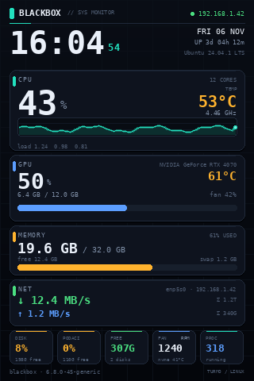
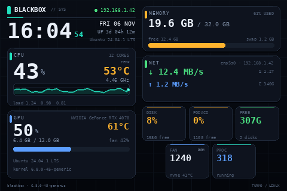
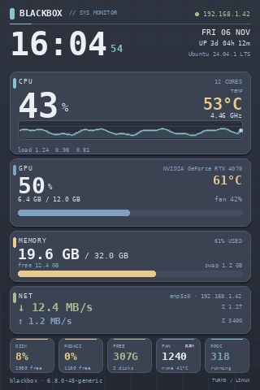
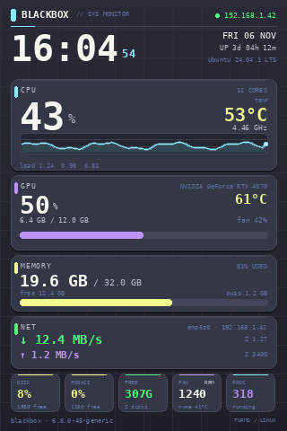
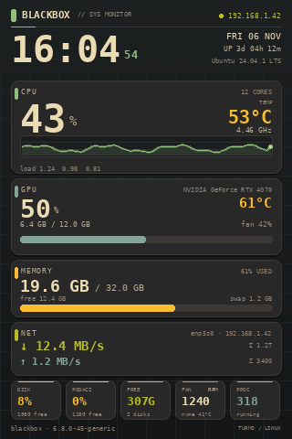
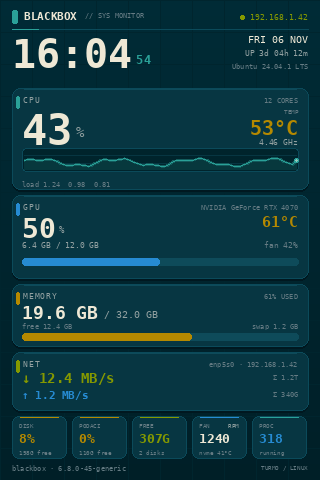
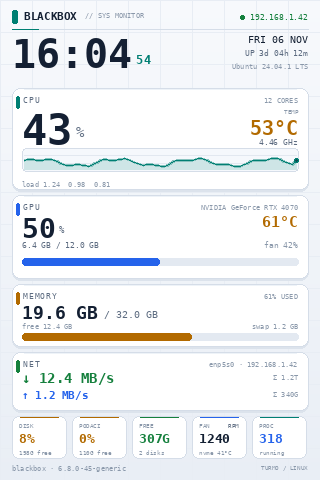
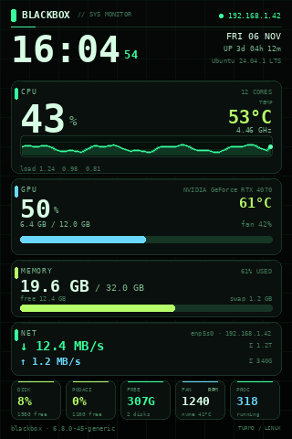
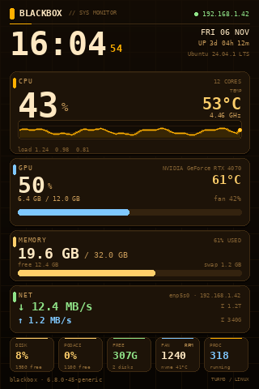
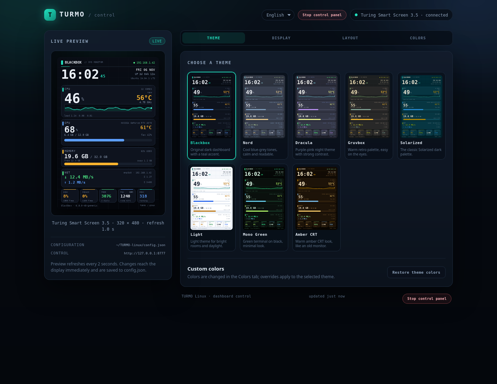

# TURMO / Turing Smart Screen — Linux driver + BLACKBOX dashboard

> **English is the primary language:** [README.md](README.md)
> Ovo je srpski prevod dokumentacije; aplikacija i podrazumevani interfejs su na
> engleskom, a GUI podržava i nemački, kineski i srpski.

Nezvanični Linux (Ubuntu) drajver i dashboard za male USB "smart screen" displeje
koje koristi i TURMO softver na Windowsu.

Podržan hardver (auto-detekcija):

| Uređaj | USB ID | Serijski broj |
|---|---|---|
| Turing Smart Screen 3.5" (rev. A) | `1a86:5722` | `USB35INCHIPSV2` |
| UsbPCMonitor 3.5" | `1a86:5722` | `USB35INCHIPSV2` |
| UsbPCMonitor 5" | `1a86:5722` | odgovara na `HELLO` |
| UsbPCMonitor 7" | `1a86:5722` | odgovara na `HELLO` |

Program radi kao sistemski servis, crta dashboard (CPU, GPU, RAM, mreža, diskovi,
ventilatori, temperature, vreme, uptime) i osvežava displej svake sekunde.

Dashboard sada ima **8 ugrađenih tema**, izbor tema iz konfiguracije ili CLI-ja,
kao i detaljne prekidače za svaki panel i svaki podatak. Tema se može dodatno
obojiti kroz `theme_colors`, bez menjanja koda. Uz displej radi i **web
kontrolna tabla** kroz koju se sve to podešava iz browsera, sa uživo pregledom.

> Napomena: `.TURMO` fajlovi (teme iz Windows programa) su zatvoren format i ne
> mogu se direktno koristiti. Ovaj program ima sopstveni renderer u
> `turmo_display/render.py`, a palete su izdvojene u `turmo_display/themes.py`.





### Galerija tema

| Blackbox | Nord | Dracula | Gruvbox |
|---|---|---|---|
|  |  |  |  |

| Solarized | Light | Mono Green | Amber CRT |
|---|---|---|---|
|  |  |  |  |

---

## 1. Instalacija na Ubuntu (22.04 / 24.04 / 25.04)

```bash
cd TURMO-linux
chmod +x install.sh uninstall.sh
sudo ./install.sh
```

Instalacija:

1. instalira `python3-venv` i `python3-pip`,
2. pravi virtuelno okruženje u `/opt/turmo-display`,
3. instalira Python biblioteke (`pyserial`, `Pillow`, `numpy`),
4. dodaje udev pravilo (displej dobija i stabilnu putanju `/dev/turmo`),
5. instalira i pokreće systemd servis `turmo-display`.

Provera:

```bash
systemctl status turmo-display
journalctl -u turmo-display -f
```

Displej treba da pokaže BLACKBOX dashboard u roku od nekoliko sekundi.

### Ručno pokretanje (bez servisa)

```bash
python3 -m venv .venv
.venv/bin/pip install -r requirements.txt
sudo .venv/bin/python -m turmo_display --config config.example.json
```

### Pregled bez displeja (renderuje PNG)

```bash
.venv/bin/python -m turmo_display --preview preview.png --fake
```

`--fake` daje lažne vrednosti, korisno za razvoj izgleda.

---

## 2. Web kontrolna tabla

Display servis radi stalno. Web GUI je **poseban proces koji se pali samo po
potrebi**, za editovanje podešavanja. Zatvaranje taba gasi editor posle nekoliko
sekundi, dugme **Stop control panel** gasi ga odmah, a display nastavlja da radi.



Šta može iz GUI-ja:

- izbor jedne od 8 tema, sa slikama svake teme,
- paljenje/gašenje svakog panela i svakog detalja (CPU temperatura, grafikon,
  swap, mrežni total, GPU memorija...),
- naslov, podnaslov, natpis u dnu i hostname,
- orijentacija (portrait/landscape) i osvetljenje,
- period osvežavanja,
- izmena svake boje izabrane teme (color picker),
- izbor jezika interfejsa: English, Deutsch, 简体中文, Srpski (bira se pri prvom
  otvaranju, kasnije u zaglavlju),
- uživo pregled onoga što je trenutno na displeju.

Promene se primenjuju odmah na displej i automatski se upisuju u `config.json`.

**Adresa:** podrazumevano `http://IP-racunara:8777` (npr.
`http://192.168.1.50:8777`) ili `http://localhost:8777` na samom računaru.

```bash
# ako je pokrenut kao korisnički servis
systemctl --user restart turmo-display

# ako je pokrenut kao sistemski servis
sudo systemctl restart turmo-display

# provera
ss -ltn | grep 8777
```

Web GUI je vezan isključivo na `127.0.0.1` — dostupan je samo na računaru na
koji je priključen displej. Nije dostupan sa telefona, druge mašine, NetBird-a
ni bilo koje mreže. Nema prijavu, ali pošto je lokalni, drugi računari ne mogu
da ga otvore niti menjaju podešavanja.

| Polje | Značenje |
|---|---|
| `web_port` | Port editora (podrazumevano `8777`, samo localhost) |

CLI alternative:

```bash
# ručno pokretanje editora (samo localhost)
python3 -m turmo_display.webapp
python3 -m turmo_display.webapp --port 8777 --idle-timeout 20
```

### Desktop prečica

```bash
./tools/install-desktop-shortcut.sh
```

Na desktop i u meni se dodaje **TURMO Control**. Pali editor po potrebi i otvara ga, a desnim klikom
ima i opcije **Edit config.json**, **Restart service** i **Stop control panel**.

```bash
./tools/install-desktop-shortcut.sh --uninstall
```

### Korisnički servis (bez root servisa)

```bash
python3 -m venv .venv
.venv/bin/pip install -r requirements.txt
./tools/install-user-service.sh
```

Skripta sama upiše tačne putanje u `~/.config/systemd/user/turmo-display.service`.

### Automatsko pokretanje pri paljenju

Servis koristi `Restart=always` i sam čeka displej ako se USB pojavi kasnije
tokom podizanja sistema.

Sistemski servis:

```bash
sudo systemctl enable --now turmo-display
systemctl is-enabled turmo-display
```

Korisnički servis:

```bash
systemctl --user enable --now turmo-display
sudo loginctl enable-linger "$USER"
systemctl --user is-enabled turmo-display
```

`enable-linger` omogućava da korisnički servis radi i pre nego što se prijaviš
na desktop. Web editor se ne pali automatski i uvek je samo na `127.0.0.1:8777`.

Posle restarta proveri:

```bash
systemctl --user is-active turmo-display   # ili: systemctl is-active turmo-display
curl -s http://127.0.0.1:8777/api/state | head -c 200
```

Displej treba da pokaže dashboard u roku od nekoliko sekundi. Ako se USB pojavi
kasnije, servis sam nastavlja da pokušava.

---

## 3. Podešavanja

Konfiguracija je u `/etc/turmo-display/config.json` (ili `config.json` pored
programa / `config.example.json`):

```json
{
  "port": "auto",
  "baud": 115200,
  "brightness": 85,
  "orientation": 0,
  "refresh_seconds": 1.0,
  "full_refresh_seconds": 30,
  "hostname": "",
  "web_port": 8777,
  "theme": "blackbox",
  "theme_colors": {},
  "title": "BLACKBOX",
  "subtitle": "",
  "footer_text": "TURMO / LINUX",
  "show_gpu": true,
  "show_system": true,
  "show_clock": true,
  "show_cpu": true,
  "show_cpu_temp": true,
  "show_cpu_freq": true,
  "show_cpu_load": true,
  "show_cpu_history": true,
  "show_memory": true,
  "show_swap": true,
  "show_network": true,
  "show_net_totals": true,
  "show_net_history": true,
  "show_gpu_mem": true,
  "show_gpu_fan": true,
  "show_tiles": true,
  "show_disk": true,
  "show_fan": true,
  "show_free": true,
  "show_procs": true,
  "show_footer": true
}
```

### Opšta podešavanja

| Polje | Značenje |
|---|---|
| `port` | `"auto"`, `/dev/ttyUSB0`, `/dev/turmo` ili `COM3` |
| `baud` | Brzina serijske veze (proizvođački protokol: `115200`) |
| `brightness` | Osvetljenje 0–100 |
| `orientation` | `0` = uspravno, `2` = položeno (landscape) |
| `refresh_seconds` | Period osvežavanja |
| `full_refresh_seconds` | Zadržano za kompatibilnost; dashboard ionako šalje celu sliku svakog ciklusa |
| `hostname` | Prazno = ime računara |
| `web_port` | Port editora (podrazumevano `8777`, samo localhost) |
| `theme` | ID teme: `blackbox`, `nord`, `dracula`, `gruvbox`, `solarized`, `light`, `mono`, `amber` |
| `theme_colors` | Opcione izmene boja izabrane teme (vidi ispod) |
| `title` | Naslov u zaglavlju (podrazumevano `BLACKBOX`) |
| `subtitle` | Mali natpis pored naslova; prazno = podrazumevani tekst |
| `footer_text` | Natpis u donjem desnom uglu |

### Šta se prikazuje

| Polje | Značenje |
|---|---|
| `show_gpu` | GPU panel kada je GPU dostupan |
| `show_system` | SYSTEM panel kada GPU nije dostupan |
| `show_clock` | Vreme, datum, uptime i distribucija |
| `show_cpu` | CPU panel |
| `show_cpu_temp` | Temperatura u CPU panelu |
| `show_cpu_freq` | Frekvencija u CPU panelu |
| `show_cpu_load` | Load average ispod CPU panela |
| `show_cpu_history` | Grafikon istorije CPU-a |
| `show_memory` | RAM panel |
| `show_swap` | Swap podatak u RAM panelu |
| `show_network` | Mrežni panel |
| `show_net_totals` | Ukupan download/upload u mrežnom panelu |
| `show_net_history` | Grafikon mrežnog saobraćaja |
| `show_gpu_mem` | VRAM podatak u GPU panelu |
| `show_gpu_fan` | Broj obrtaja/Procenat ventilatora GPU-a |
| `show_tiles` | Donji tile-ovi (uključuje sve ispod) |
| `show_disk` | DISK tile(ovi) — po jedan za svaki od dva diska, inače zbirno |
| `show_fan` | FAN tile |
| `show_free` | FREE tile (slobodno na disku) |
| `show_procs` | PROC tile (broj procesa) |
| `show_footer` | Hostname/kernel i natpis u dnu |

Sve `show_*` opcije su podrazumevano `true`. Kada neki panel isključiš,
preostali se automatski rastežu da popune ekran — nema praznih rupa.

### Teme

Lista dostupnih tema:

```bash
python3 -m turmo_display --list-themes
```

Preview jedne teme bez displeja:

```bash
python3 -m turmo_display --preview /tmp/nord.png --fake --theme nord
```

Tema se bira u konfiguraciji:

```json
"theme": "nord"
```

ili privremeno preko CLI-ja:

```bash
python3 -m turmo_display --theme dracula
```

Svaka tema može da se prilagodi bez pravljenja nove teme. Dovoljno je izabrati
osnovnu temu i promeniti željene boje:

```json
"theme": "blackbox",
"theme_colors": {
  "accent": "#ff8800",
  "bg_top": "#101418",
  "bg_bottom": "#05070a",
  "text": "#f5f7fb"
}
```

Dostupni ključevi boja:

`bg_top`, `bg_bottom`, `grid`, `card`, `card_shadow`, `border`, `highlight`,
`track`, `text`, `muted`, `dim`, `accent`, `amber`, `blue`, `green`, `red`,
`plot_bg`, `plot_grid`.

Boje se mogu pisati kao `#ff8800`, `ff8800` ili `[255, 136, 0]`.

Posle izmene konfiguracije:

```bash
sudo systemctl restart turmo-display
# ili, za korisnički servis:
systemctl --user restart turmo-display
```

### Automatsko pokretanje pri podizanju sistema

`install.sh` instalira sistemski servis i odmah ga uključi (`systemctl enable`),
pa se dashboard sam pokreće pri svakom bootu.

Ako program radi kao **korisnički** servis (iz tvog home direktorijuma), primer
je u `systemd/turmo-display-user.service`:

```bash
mkdir -p ~/.config/systemd/user
cp systemd/turmo-display-user.service ~/.config/systemd/user/turmo-display.service
systemctl --user daemon-reload
systemctl --user enable turmo-display.service
loginctl enable-linger "$USER"      # pokretanje i pre prijave na desktop
systemctl --user restart turmo-display.service
```

Provera da li je servis uključen:

```bash
systemctl --user is-enabled turmo-display.service
# očekivano: enabled
```

Auto-detekcija porta sada ponovo traži displej pri svakom pokušaju, pa ako se
USB pojavi tek nekoliko sekundi posle boota, dashboard će se sam povezati.
Ako displej ipak ostane crn, pogledaj:

```bash
journalctl --user -u turmo-display -n 50 --no-pager
```

---

## 4. Šta se prikazuje

- Vreme i datum, hostname, uptime, kernel
- CPU: zauzeće, temperatura, frekvencija, broj jezgara, load average, istorija
- GPU: NVIDIA (`nvidia-smi`) ili AMD (`/sys/class/drm`), zauzeće/temp/VRAM/fan
- RAM i swap (sa istorijom zauzeća)
- Mreža: default interfejs, IP, download/upload, ukupno
- Diskovi: svi montirani SSD/HDD uređaji (`/`, `/mnt/...`, `/media/...`) —
  zauzeće i slobodan prostor po disku; za dva diska dobijaš dva tile-a
- Ventilatori (hwmon), NVMe temperatura, broj procesa
- 8 tema i proizvoljne izmene boja; svaki panel i detalj se mogu isključiti

Senzori se čitaju iz `/proc` i `/sys`, bez dodatnih servisa. Za NVIDIA GPU
dovoljan je instaliran drajver (`nvidia-smi`).

---

## 5. Rešavanje problema

**`Permission denied` na `/dev/ttyUSB0`**

```bash
sudo usermod -aG dialout "$USER"
# odjavi se i prijavi ponovo
```

Servis radi kao root, pa mu ovo nije potrebno; potrebno je samo za ručno pokretanje.

**Port je zauzet**

Zatvori Windows aplikaciju (TURMO / USBMonitor) ako si u dual-bootu, ili bilo koji
drugi program koji drži `ttyUSB`. Provera:

```bash
sudo lsof /dev/ttyUSB0
```

**Displej se ne pojavljuje**

```bash
dmesg | tail -20
lsusb | grep 1a86
ls -l /dev/ttyUSB* /dev/turmo
```

Ako nema `/dev/ttyUSB*`, proveri kabl (mora da prenosi podatke, ne samo struju)
i probaj drugi USB port.

**Test obrazac (provera veze/boja)**

```bash
sudo /opt/turmo-display/venv/bin/python /opt/turmo-display/tools/test_pattern.py
```

Ako se pojave obojene trake i natpis `OK`, veza i protokol rade.

**Prvo iscrtavanje može da potraje nekoliko sekundi**

Prva cela slika se šalje preko serijske veze; zatim se pri svakom osvežavanju
šalje nova kompletna slika, pa je osvežavanje ~1 s.

**Displej je beli/žut ili izmešan**

Proveri `orientation` i da li je model 3.5" (320×480). Program sam pita displej za
model preko `HELLO` komande; ako model ne odgovori, pretpostavlja 320×480.

---

## 6. Struktura

```
TURMO-linux/
├── install.sh              # instalacija na Ubuntu
├── uninstall.sh
├── requirements.txt
├── config.example.json
├── config.json             # aktivna konfiguracija (opcije prikaza)
├── systemd/
│   ├── turmo-display.service       # sistemski servis (root, /opt)
│   └── turmo-display-user.service  # korisnički servis (~/.config)
├── udev/99-turmo-display.rules
├── tools/
│   ├── test_pattern.py     # test displeja (boje + OK)
│   └── preview_themes.py   # preview svih tema u PNG
├── tests/                  # render + web testovi bez displeja
├── docs/                   # preview slike, galerija tema, GUI snimak
└── turmo_display/
    ├── __main__.py         # CLI za display
    ├── webapp.py           # editor koji se pali po potrebi
    ├── app.py              # glavna petlja, slanje slike
    ├── lcd.py              # Turing rev. A serijski protokol
    ├── stats.py            # /proc i /sys senzori
    ├── themes.py           # palete i custom boje
    ├── render.py           # BLACKBOX dashboard (Pillow)
    ├── runtime.py          # deljeno stanje displej ↔ web
    └── webui/              # web kontrolna tabla (HTML/CSS/JS + server)
```

## 7. Razvoj i testovi

Render se može testirati bez displeja i bez stvarnih senzora:

```bash
python3 -m unittest discover -s tests -v
```

Preview svih tema:

```bash
python3 tools/preview_themes.py docs/themes
```

Preview jedne konfiguracije:

```bash
python3 -m turmo_display --preview /tmp/turmo.png --fake --theme gruvbox
```

## 8. Licenca

Protokol je reimplementiran prema javno dostupnoj dokumentaciji projekta
[turing-smart-screen-python](https://github.com/mathoudebine/turing-smart-screen-python)
(GPL-3.0). Ovaj projekat je nezvaničan i nije povezan sa TURMO/Turing/TURZX.
